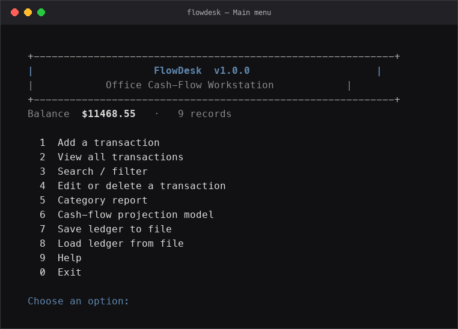
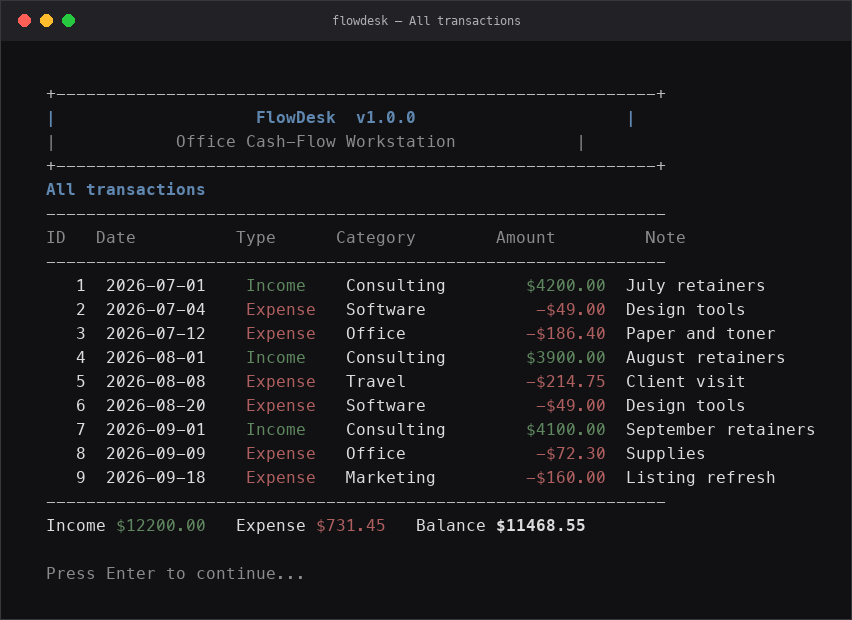
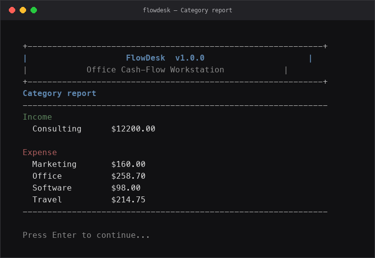
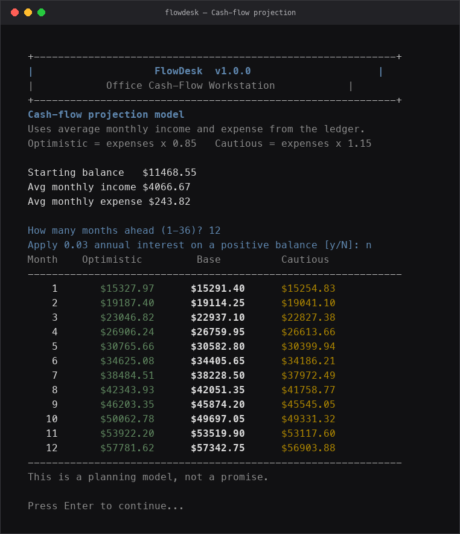

# project-2
Portfolio Project #2 — A C/C++ application developed with the assistance of AI tools, featuring a user interface, preprocessor directives, and error-free compilation. The project demonstrates practical programming concepts and a fully functional user experience.

**FlowDesk** is the programme: an office cash-flow ledger with a three-scenario projection model.

## Official brief (Steps 1–5)

| Step | Brief | This project |
| --- | --- | --- |
| 1 | Choose C or C++ | **C++17**. Classes keep the ledger, projector, storage, and UI in separate files. |
| 2 | Purpose: office use, model projections, or a game | **Office ledger** plus a **1–36 month projection** (optimistic / base / cautious). |
| 3 | Write the programme and use preprocessor directives before compiling | Original source in `src/` and `include/`. Directives live in `include/config.h`. |
| 4 | Compile with an approved compiler | **Clang** (`make`). **GCC** (`make gcc`). Both are on the approved list. |
| 5 | Run it, exhaust every option, leave with `return 0` | Numbered menu 0–9. Option **0** saves `data/ledger.csv` and returns `0`. |

Peers were optional. This submission is a complete solo programme.

### Step 3 — preprocessor (before the compiler)

`include/config.h` uses `#ifndef` / `#define` / `#endif` (header guard), `#define` limits and scenario bands, `#if` for Windows vs Mac, `#ifdef FLOWDESK_COLOR` for colour, `#error` if the dialect is older than C++17, and `#pragma message` at compile time.

```text
warning: Preprocessor: compiling FlowDesk 1.0.0 (color UI)
```

That line appears while Clang runs. It proves the preprocessor ran first.

### Step 5 — exhaust the menu, then `return 0`

1. Add a transaction  
2. View all transactions  
3. Search / filter  
4. Edit or delete  
5. Category report  
6. Cash-flow projection  
7. Save ledger  
8. Load ledger  
9. Help  
0. Exit — prints “finished with return 0”

Then:

```bash
echo $?
```

It should print `0`.

## Screenshots

Main menu with the current balance and every option:



Ledger view after loading the sample office records:



Income and expense grouped by category:



12-month cash-flow projection (optimistic / base / cautious, interest off):



## Run

```bash
make
./flowdesk
```

Choose `0` to leave. The program writes `data/ledger.csv` and returns `0`.

Presentation script: `PRESENTATION.md`.
